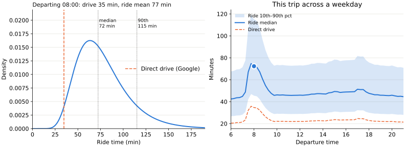
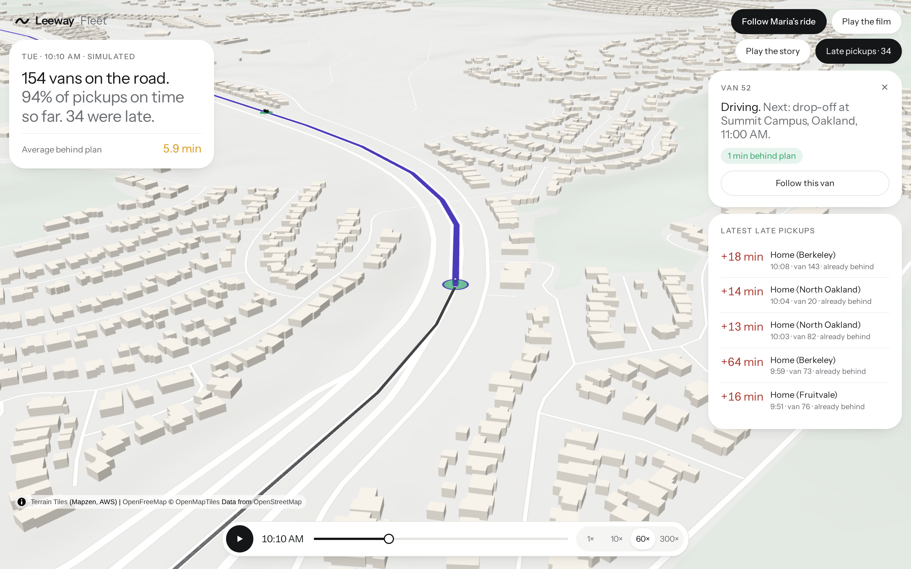

# Leeway

One of our team member’s former boss lives with severe multiple sclerosis (PPMS) and is fully paralyzed. Because he uses a specialized wheelchair, paratransit is essential for getting to appointments. The service’s unpredictability means he must schedule a lot of extra time to account for potential delays or pay much more for a less disability-friendly Uber. That places an additional burden on both him and his caretaker.

**The law:** The Americans with Disabilities Act (ADA) requires public transit agencies to provide complementary paratransit services for eligible people with disabilities who cannot use fixed-route transit.

**The problem:** The service exists, but it's burdensome. For East Bay Paratransit:
- You must call to book (no app available)
- As long as the van comes **within 30 minutes** of the start of the booking window, the **ride counts as punctual**. Despite that loose definition, 5% arrive even later. So if you take paratransit twice a day to and from work, you wait more than 30 minutes every second week. Drivers only wait 5 minutes before they leave.

**Our Solution:** Leeway
- Recommends booking windows based on historical ride data
- Calls to schedule the initial ride using [Cartesia's voice agent](https://www.cartesia.ai/learn/voice-agent).
- Predicts *live* the likelihood of arriving on time
- Proactively helps riders navigate delays, including calling the provider to reschedule appointments, also using [Cartesia](https://www.cartesia.ai/learn/voice-agent).


## Prediction

```
arrival = booking_start + pickup_delay + travel_time
```

### Pickup Delay

#### No Previous Rides

When a user hasn't taken any trips yet, the best we can do is to tell them how trips behave *in general*. 

| Metric | Jul '25–Apr '26 |
|---|---|
| Percent on time | 94.7% |
| 1–20 minutes past window | 4.42% |
| 21–59 minutes past window | 0.79% |
| 60+ minutes past window | 0.06% |

We assume that the delay is roughly distributed like a **shifted log-normal** and find the parameters that minimize the deviation from those values (our error). We fix the shift at -5 to allow for too early pickups.


This estimate is still very crude because the time of day makes a big difference: a van caught in rush hour traffic driving arrives late with higher probability.

We don't have access to more fine grained information for the East Bay. However, the transit authority in NYC publishes extensive reports on their paratransit system, including delays at different times of day. Our hypothesis is that at times **when the system in NYC is late more often, the system in East Bay is too**. 

In other words, if the the mean lateness in NY at time $t$ is $g(t)$ higher than regular, then the mean lateness in East Bay at time $t$ is also $g(t)$ higher than regular ($\,\mu(t) = \mu_{\text{base}} + g(t)\,$)

We still want to get the same probabilities for falling into the different buckets from the table earlier, so we optimize $\mu_{\text{base}}$ and our standard deviation so those match.


NYC only reports one value per hour, so we only know $g(t)$ once per hour, but riders book at any minute. We need a smooth curve through those points, so we first tried a polynomial. Some might say the result was slightly unrealistic (shoutout to Runge's phenomenon):


We ultimately settled for a **cubic spline to interpolate** the datapoints. We didn't smooth the points with a least-squares fit because each hourly value already rests on 30k–2M NYC trips.

#### Previous Trips

Once a user has done a couple of trips, we can use when they were actually picked up to make better predictions.

We add **two personal offsets** to the general estimate: one that follows the rider everywhere (maybe their building is hard to find) and one per recurring trip (maybe the Tuesday dialysis ride is always rough), so $\,\mu(t) = \mu_{\text{base}} + g(t) + \delta_{\text{rider}} + \delta_{\text{trip}}\,$. Both start at zero, and a trip only counts by how much it *surprised* us: 15 minutes late is normal at 5pm, but not at 10am.

- **Older trips count less:** each trip loses 10% of its weight per week
- **Same-route trips count more:** they move both offsets, other trips only move the rider offset
- **More trips, more trust:** the general estimate is our prior, so one late pickup barely moves the offsets, but ten do

Under the hood this is a **Bayesian linear regression**: fading old trips = treating them as noisier measurements (heteroscedastic noise!).

### Travel Time

Google Maps takes traffic data into account. Therefore, our initial idea was to use Google Maps via the Google Routes API to estimate how long a ride takes. But a shared van picks up and drops off other riders along the way, so we multiply Google's drive time by about 2.2. 

We know that the average paratransit trip in East Bay is 11.43 miles and takes 48.9 minutes. We therefore sampled 120 trips between BART stations across the service area and asked Google how long each would take. After weighting them so that we matched the length, we get an average travel time of 22 minutes, so the factor is 48.9 / 22 = 2.2.

This is great for the *average* case. But we care most about what happens in the slow tail. That's when we might need to reschedule. We therefore again used NYC data to inform our choice of spread.


*Example trip: Hayward to Highland Hospital, Oakland (14 mi). Most affected by morning traffic because it runs toward Oakland with the morning commute, and against the evening one.*

### Calculating the Arrival

The rider is on time if `pickup_delay + travel_time` fits between `booking_start` and the appointment. There's no closed formula for the sum of our two distributions, so we go one pickup delay at a time: if the van is 15 minutes late, how likely is the ride to fit into the time that's left? We average that over **2,000 evenly spaced quantiles** of the pickup delay. That's deterministic and takes about 1 ms, so it reruns whenever something changes:

- **Still waiting:** delays that are no longer possible drop out, so the probability falls the longer the van doesn't show
- **On board:** the pickup delay is known, and only the ride is uncertain

### Future: Waze for Paratransit

East Bay Paratransit doesn't publish delays by time of day, so we borrow them from New York. But every Leeway trip records when the van came and how long the ride took (without saving the exact GPS path). Pooled across riders, anonymized and with their consent, that becomes real, live East Bay data: if vans in Hayward are running late right now, riders waiting there can reschedule before their own van is late.

## Solution Development & Research

We read forums and public discussions and did street interviews. Two priorities came out of them:
- **Less waiting and fewer phone calls:** Leeway suggests how early to book, and if the van runs late, it calls the appointment so the rider or caretaker doesn't have to.
- **Control stays with the rider:** people worried about AI acting alone and seeing their personal data, so Leeway asks before every consequential step.

**Prototyping with Claude:** We wireframed Leeway in Claude Design, starting broad and narrowing to the key screens of one clear user flow. After several rounds of feedback from street interviews, we handed the design files to Claude Code to build the front-end prototype.


## Mobile App

**Design objective:** Reducing cognitive load, proactively taking action, and preserving user agency.

**Key design choices**
- Minimal graphics and clear visual hierarchy centered on the likelihood of arriving on time and the options available if a delay occurs.
- Proactive assistance that anticipates problems and takes action on the user's behalf, seeking consent for consequential decisions.
- Continuous, transparent updates so users know what Leeway did, the outcome, and what happens next.
- Visible AI actions, call transcripts, and a conversational assistant with chat history.
- When arrival probability drops below a defined threshold, Leeway proactively explores alternatives and asks for approval before committing to another ride.

**Accessibility**
- Design goal: Aim for WCAG 2.2 AAA conformance where feasible.
- Future improvements: Add customizable accessibility settings, including text size, voice input and control, and color-vision preferences, alongside stronger screen-reader support and descriptive alt text.
- Ongoing validation: Test with real riders and caregivers, using their feedback and consented trip outcomes to improve the experience and predictions.

## Simulation

Real data is coarse: EBP publishes on-time rates per month, not individual rides. To test our predictions, we **simulate a full day of East Bay Paratransit** and tune it until its punctuality matches EBP's numbers.

**Trips:** 7,000 synthetic riders, each with a home in one of 18 neighborhoods from Richmond to Fremont, a reason to travel (dialysis, medical appointments, senior programs or errands), a nearby destination and a mobility type that sets how long boarding takes. That's about **2,400 one-way trips per weekday**, close to what EBP reports.

**Vans:** each request goes into the van route it delays least, within a 30-minute pickup window, ride-time limits and driver shifts. Driving times come from real road distances (OSRM).

**Delays:** each leg gets log-normal traffic noise, wider at rush hour, plus incidents, hard-to-find addresses, riders who aren't ready, breakdowns and late shift starts. Each stop starts when the previous one ends, so delays carry down the route. 96% of late pickups came from vans already 15+ minutes behind when they left the previous stop: **lateness is mostly inherited**.



**Calibration:** we tune only how optimistic the van scheduler is about travel times, using a bisection search until the on-time rate matches EBP's. We didn't tune the other numbers:

| Metric | Simulation (14 days) | EBP (published) |
|---|---|---|
| On-time pickups | 88.0% | 87.9% |
| More than 60 min late | 0.27% | 0.20% |
| Rider no-shows | 2.2% | 2.6% |

## Cartesia Integration

East Bay Paratransit only takes bookings by phone, and clinics are reached by phone too. When a ride runs late, someone has to call the appointment, usually the rider waiting at the curb. With Leeway, a **Cartesia phone agent makes that call**, and the rider can **talk to Leeway** instead of typing.

**Three phone agents** (Agents API, Claude Haiku as the LLM, one shared voice):
- **Policy inquiry:** before booking, asks the appointment how late the rider can arrive and still be seen. That grace period moves the deadline the model predicts against, so Leeway books only as early as needed.
- **Late notice:** when the chance of arriving on time drops below 50%, calls with the model's estimated arrival and asks whether the rider can still be seen.
- **Rider message:** passes on a message the rider dictated and brings back the reply.

**How a call works:**
- **Dynamic variables** fill in the rider, the appointment and the delay, so one agent covers every rider.
- **Webhook tools** return typed results (`grace_minutes`, `appointment_held`, …) that the app acts on. If the agent hangs up without reporting, Claude Haiku reads the transcript instead.
- **Live transcripts** show the call in the app as it happens.

**In the app:** hold the mic and say what you need. **Ink-Whisper** transcribes it, and **Sonic 3.6** reads Leeway's reply aloud in the phone agents' voice.

**Responsible calling:** Leeway only calls within each trip's permissions, and in the app it asks before calling about a delay. The agents say they are automated and share only the rider's name, the appointment time and the delay. The server only dials approved US/Canada numbers, never real agency lines, and at most 4 times an hour per number. The East Bay Paratransit booking call is a mock, since we never call real agency lines.
