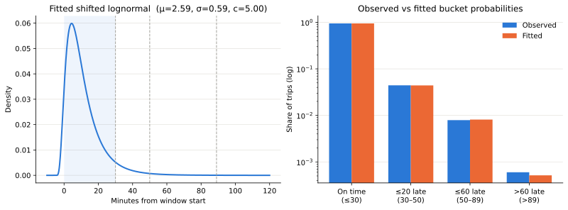
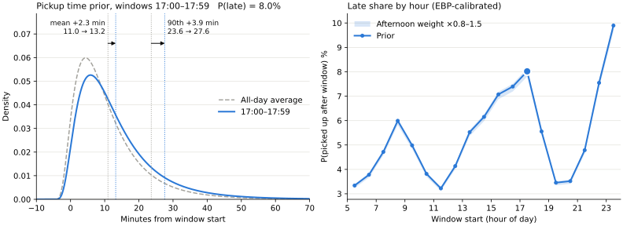
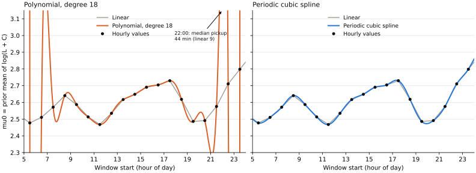
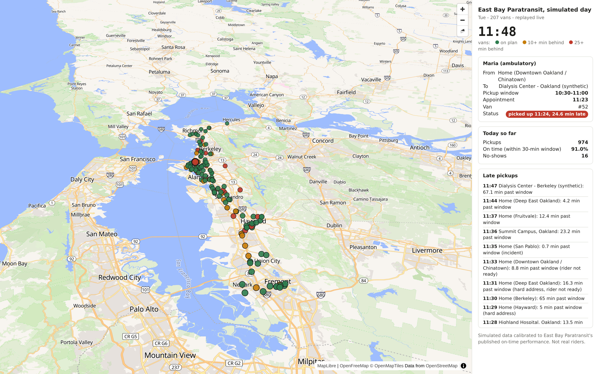

# Leeway

**The law:** The Americans with Disabilities Act (ADA) requires public transit agencies to provide complementary paratransit services for eligible people with disabilities who cannot use fixed-route transit.

**The problem:** The service exists, but it's burdensome. For East Bay Paratransit:
- You must call to book (no app available)
- As long as the van comes **within 30 minutes** of the start of the booking window, the **ride counts as punctual**. Despite that loose definition, 5% arrive even later. So if you take paratransit twice a day to and from work, you arrive more than 30 minutes late every second week. Drivers only wait 5 minutes before they leave.

**Our Solution:** Leeway
- Recommends booking windows based on historical ride data
- Calls to schedule the initial ride using [Cartesia's voice agent](https://www.cartesia.ai/learn/voice-agent).
- Predicts *live* the likelihood of arriving on time
- Proactively helps riders navigate delays, including calling the provider to reschedule appointments, also using [Cartesia](https://www.cartesia.ai/learn/voice-agent).

## Prediction

### L: 

#### No Previous Rides

When a user hasn't taken any trips yet, the best we can do is to tell them how trips behave *in general*. 

| Metric | Jul '25–Apr '26 |
|---|---|
| Percent on time | 94.7% |
| 1–20 minutes past window | 4.42% |
| 21–59 minutes past window | 0.79% |
| 60+ minutes past window | 0.06% |

We assume that the delay is roughly **distributed like a shifted log-normal** and find the parameters that minimize the deviation from those values (our error). We fix the shift at -5 to allow for too early pickups.

This estimate is still very crude because the time of day makes a big difference: a van caught in rush hour traffic driving arrives late with higher probability.

We don't have access to more fine grained information for the East Bay. The transit authority in NYC publishes extensive reports on their paratransit system, including delays at different times of day. Our hypothesis is that at times **when the system in NYC is late more often, the system in East Bay is too**. 

In other words, if the the mean lateness in NY at time $t$ is $g(t)$ higher than regular, then the mean lateness in East Bay at time $t$ is also $g(t)$ higher than regular ($\,\mu(t) = \mu_{\text{base}} + g(t)\,$)

We still want to get the same probabilities for falling into the different buckets from the table earlier, so we optimize $\mu_{\text{base}}$ and our standard deviation so those match.

We noticed that our mean and therefore our offset $g(t)$ is very ragged, so we wanted to interpolate it using a polynomial. Some might say the result was slightly unrealistic (shoutout to the Runge phenomena):

We ultimately settled for a **cubic spline to interpolate** the datapoints. We considered using a least squares fit but decided against it since each of the data points is backed by many datapoints.

#### Previous Trips

Once a user has done a couple of trips, we can use when they were actually picked up to make better predictions.

We add **two personal offsets** to the general estimate: one that follows the rider everywhere (maybe their building is hard to find) and one per recurring trip (maybe the Tuesday dialysis ride is always rough), so $\,\mu(t) = \mu_{\text{base}} + g(t) + \delta_{\text{rider}} + \delta_{\text{trip}}\,$. Both start at zero, and a trip only counts by how much it *surprised* us: 15 minutes late is normal at 5pm, but not at 10am.

- **Older trips count less:** each trip loses 10% of its weight per week
- **Same-route trips count more:** they move both offsets, other trips only move the rider offset
- **More trips, more trust:** the general estimate is our prior, so one late pickup barely moves the offsets, but ten do

Under the hood this is a **Bayesian linear regression**: fading old trips = treating them as noisier measurements (heteroscedastic noise!).

### R

Our initial idea was to use Google Maps via the Google Routes API to estimate how long a ride takes. This 

How can we address this?

A shared van takes longer than driving straight there. 

### Calculating the Arrival

Both L and R have a shifted log-normal distribution. Unfortunately, there exists no closed-form solution to its cumulative probability distribution.

Sample 2000 points and 

### Future: Waze for Paratransport

## Mobile App

**Design Considerations:** Reducing cognitive load, proactively taking action, and preserving user agency.

**Key design choices**

- Minimal graphics and clear visual hierarchy centered on arrival probability and trip status.
- Proactive assistance that anticipates problems and takes action on the user's behalf, seeking consent for consequential decisions.
- Continuous, transparent updates so users know what Leeway did, the outcome, and what happens next.
- Visible AI actions, call transcripts, and a conversational assistant with chat history.
- When arrival probability drops below a defined threshold, Leeway proactively explores alternatives and asks for approval before committing to another ride.

**Accessibility**

- Target WCAG 2.2 AAA standards where feasible.
- During setup, users can customize accessibility preferences, including text size, voice input and control, and color-vision needs.
- Support screen readers with descriptive alt text, strong contrast, and large touch targets.
- Test with real riders and caregivers, using their feedback and consented trip outcomes to improve the experience and predictions.

## Simulation

We don't have much real data, and what we have is coarse: on-time percentages per month, not individual rides. So to train and test our predictions, we **generate synthetic rides** that behave like the real ones, and tune the simulation until its punctuality matches what East Bay Paratransit publishes.

#### Generating likely trips

We create a pool of 7,000 synthetic riders. Each one gets:
- **a home** in one of 18 East Bay neighborhoods, from Richmond to Fremont
- **a reason to travel**: dialysis (20%), medical appointments (30%), senior programs (30%) or other errands (20%)
- **a usual destination**, usually one close by: real hospitals, plus placeholder dialysis centers, senior centers and stores
- **a mobility type** (ambulatory, walker or wheelchair), which sets how long boarding takes

The purpose sets the rhythm. Dialysis riders go three times a week (Mon/Wed/Fri or Tue/Thu/Sat) at fixed chair times, senior programs start around 9:30am, and medical appointments are spread over the day on the quarter hour. Riders with an appointment ask to be picked up early enough to arrive 30 minutes ahead, and every trip out comes with a trip back once the appointment is over. We draw riders until we reach about **2,400 one-way trips per weekday** and a bit under a third of that on weekends, which is about what EBP reports.

#### Scheduling the vans

A greedy scheduler, standing in for the agency's software, puts each request into whichever van route it adds the least extra time to. It promises every rider a 30-minute window, respects ride-time limits, appointment times and driver shifts, and may move a pickup by up to an hour, just like the agency. Driving times come from real road distances (OSRM) and hourly speeds.

#### Making vans late

Then we drive those routes through a noisy world. Each leg gets **log-normal traffic noise** that spreads wider at rush hour, plus the occasional incident, hard-to-find address, rider who isn't ready (after 5 minutes it's a no-show), slow boarding, breakdown or late shift start. Each stop starts when the previous one ends, so **lateness cascades** down the route.

Every stop also records *why* it ran late, which gives us a labeled dataset for free. One thing stood out: 96% of late pickups came from vans that were already 15+ minutes behind plan when they left the previous stop. **Lateness is mostly inherited**, so you can see it coming long before the van arrives, which is what makes live prediction possible.

#### Calibration

The knob we tune is **how optimistic the planner is** about travel times. Plan too tight and vans carry more riders but show up late more often. Since on-time performance only goes up as the plan gets looser, a simple **bisection search** finds the setting that hits the published on-time rate.

We left everything else alone and used it as a sanity check:

| Metric | Simulation (14 days) | EBP (published) |
|---|---|---|
| On-time pickups | 88.0% | 87.9% |
| More than 60 min late | 0.27% | 0.20% |
| Rider no-shows | 2.2% | 2.6% |
| Van minutes per passenger | 46.6 | 42.0 |
| Miles per passenger | 6.6 | 9.8 |

Miles per passenger is too low: our trips are a bit too local, or shared too efficiently.